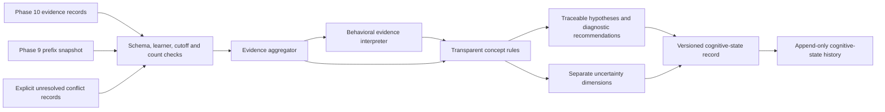
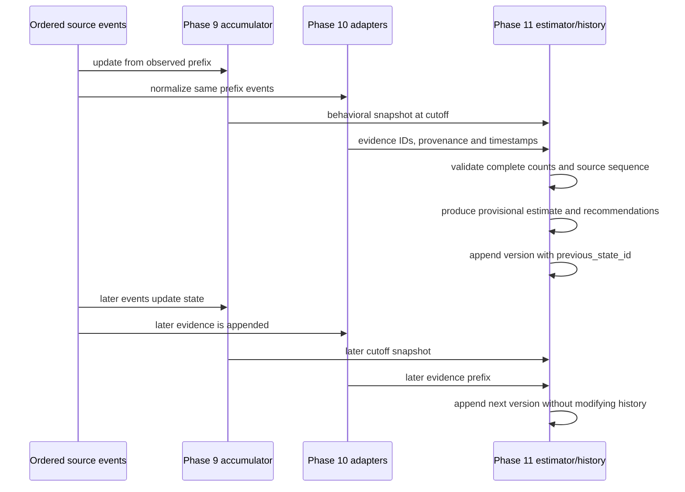

# Phase 11: Cognitive-State Estimation Architecture

## Scope and boundaries

Phase 11 adds a distinct, versioned cognitive-state estimate that consumes a complete, cutoff-aligned Phase 9 behavioral snapshot and its Phase 10 evidence records. It does not alter the Phase 9 schema or math. EdNet supplies correctness outcomes and item skill tags, not ground-truth understanding, confusion, misconceptions, representation difficulty, or cognitive-state labels. Therefore the generated categories are provisional rules over response behavior and every cognitive inference remains low-confidence.

The implementation never treats predicted correctness as evidence of understanding. It does not emit a misconception label. A repeated-error or performance-trend hypothesis only recommends collecting more evidence.

## Data flow

The aggregator accepts all Phase 10 types: interaction, temporal history, text, audio and visual. Unannotated text/audio/visual content is preserved as evidence but is not semantically interpreted. A representation-difficulty hypothesis is emitted only from a caller-supplied human annotation carrying an annotation type, concept ID, annotator ID and method; it remains low support.

## State lifecycle

`CognitiveStateHistory` is an in-memory append-only interface. It assigns a consecutive `state_version`, links `previous_state_id`, checks source-sequence monotonicity, and records concept-status/evidence/hypothesis changes. The bounded data builder serializes those versions as JSONL. A hypothesis that is no longer emitted is marked “no longer emitted”; it is not automatically called resolved.

## Responsibilities

| Component | Responsibility | Boundary |
|---|---|---|
| Phase 9 interpreter | Reuse observed counts, historical/recent correctness, trends, Wilson intervals, evidence tiers and potential-issue flags. | No formulas are changed and the `phase9_behavioral_confidence` is kept separate from cognitive-estimate confidence. |
| Evidence aggregator | Validate same learner, complete interaction counts, per-concept labeled counts, timestamps/sequence, provenance and explicit conflicts. | Rejects partial or future-contaminated interaction evidence instead of silently filling gaps. |
| Concept estimator | Apply documented status rules to Phase 9 concept summaries. | Produces a provisional behavioral category; no cognition probability is claimed. |
| Hypothesis generator | Emit insufficient-evidence, repeated-error, decline, inconsistency, explicit representation annotation, or conflict hypotheses. | Every hypothesis cites evidence IDs; ordinary incorrect responses never create a misconception label. |
| Uncertainty estimator | Track evidence, temporal, modality, inference and overall uncertainty separately. | Current EdNet inference uncertainty is high because there are no cognitive labels. |
| Diagnostic recommender | Suggest a diagnostic question, explanation request or clarification. | Recommendations only; no representation/intervention engine is implemented. |

## Traceability

Every concept estimate cites the normalized interaction evidence supporting its observed counts. Source dataset, file/member, source record ID, event time and sequence are carried in `evidence_references`. Contradictory evidence IDs are kept on the affected concept and hypothesis. The validator checks that all referenced evidence is present and that interaction and per-concept counts match Phase 9 exactly.

## Limitations

Only EdNet interaction and derived temporal history were evaluated on real learner data. The local EdNet skill tags are item metadata, not a validated concept ontology. Text, audio and visual adapters were tested with synthetic fixtures; there is no learner-authored explanation, speech, image, OCR or ASR output in the local snapshot. No cognitive-state ground truth exists, so Phase 11 has descriptive rule coverage tests but no accuracy, calibration, or construct-validity result.
