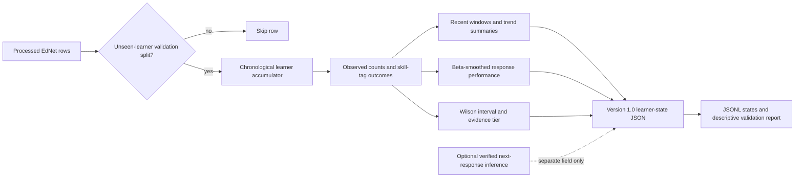

# Phase 9 — Learner State Representation Architecture

## Scope

This module creates versioned summaries of observed EdNet interaction history. Its estimates describe response performance on tagged items. They are not labels or direct measurements of understanding, mastery, confusion, or misconceptions. EdNet skill tags are preserved as dataset item metadata and are not upgraded into a validated concept ontology.

## Data flow

Each input row updates one learner accumulator. A snapshot represents the evidence available after all rows passed to that accumulator, never after rows that have not yet been seen. The batch script consumes the existing processed stream and emits one final state per unseen-learner validation learner. It retains only a current learner's concept counters/deques plus a set of completed IDs for contiguous-group validation.

## State fields by evidence type

| Field family | Evidence status | Meaning |
|---|---|---|
| Learner ID, timestamp, interaction count, labeled/unlabeled counts, duplicate count | Directly observed/provenance | Preserved pseudonymous EdNet learner identifier and processed row metadata. The timestamp is EdNet's shifted question-given timestamp. |
| Concept/skill ID and last interaction | Direct item metadata/provenance | Distinct IDs are emitted as `ednet_skill:<raw tag>`. If one item has several tags, each concept receives one event incidence. Duplicate tags on a row are collapsed. |
| Correct/incorrect counts and accuracy | Observed outcome / direct arithmetic | Correctness was derived during existing preprocessing from submitted answer versus official answer key. It is a response result, not a cognitive label. |
| Recent performance, change, trend | Derived estimate | Recent performance uses up to 10 latest labeled responses overall and up to 5 per skill. Trend compares latest 5 with the preceding 5. |
| Smoothed performance | Bayesian-smoothed outcome estimate | Posterior mean for a Beta-Binomial model with uniform Beta(1,1) prior. It is a stabilized estimate of future response correctness under exchangeability, not understanding. |
| Evidence sufficiency/confidence/uncertainty | Heuristic evidence summary | Based on sample count and width of a 95% Wilson interval around the observed response-correctness proportion. Labels are ordinal; no probability of being correct about cognition is claimed. |
| Potential issues | Heuristic screening flags | Repeated incorrect recent responses, a decline, mixed recent outcomes, or little evidence. Each signals follow-up investigation only. |
| Next-response probability | Model-inferred, optional | Separate from performance estimates. In the current Phase 9 run this is `null`: no existing predictor could be loaded in the available environment. |
| Understanding, confusion, misconception, representation need | Unknown | No suitable direct ground-truth labels exist in EdNet. These fields are not inferred or synthesized. |

## Temporal update rules

1. Require a stable learner ID, strictly increasing source-row order, and nondecreasing parseable timestamps.
2. Count every processed row as an interaction. Missing-answer rows count as unlabelled interactions, but do not change correctness counts, trends, or Beta parameters.
3. For each available skill tag, retain the last observed question, source-row order and timestamp. Only labeled responses increment its attempt/correct/incorrect counts.
4. Update global and concept histories after recording the event. Snapshotting at any prefix reconstructs the state at that point in the stream.
5. Do not sort tied timestamps; source row order already resolves ties in the processed dataset. Reject descending timestamps rather than reorder.
6. Use only `split_unseen_learner=validation` in the evaluation/export script. Training and test rows never enter emitted Phase 9 states. No test labels or test states are read.

This is an append-by-replay update API, not a durable state database. Callers preserve history by storing each snapshot with its source cutoff; the module does not overwrite earlier snapshots.

## Optional prediction integration

`LearnerStateAccumulator.set_next_response_prediction(probability, model_name)` accepts only an explicitly supplied finite probability in `[0,1]`. It is serialized in `model_predictions.next_response_correctness`, with an interpretation label. It never changes `learning_performance` or concept estimates. The Phase 6–8 reports show validation performance, but reports alone do not provide per-event prediction outputs. This environment has no joblib, scikit-learn, XGBoost or PyTorch runtime, so model inference was not attempted and no prediction was invented.

## Integration boundary

Phase 9 advances Layer 2 infrastructure by defining an inspectable learner/skill response-history state and a no-future-data update contract. It does not implement multimodal evidence fusion, a cognitive state estimator, an adaptive representation planner, post-intervention outcome updates, or an end-to-end teaching system.
