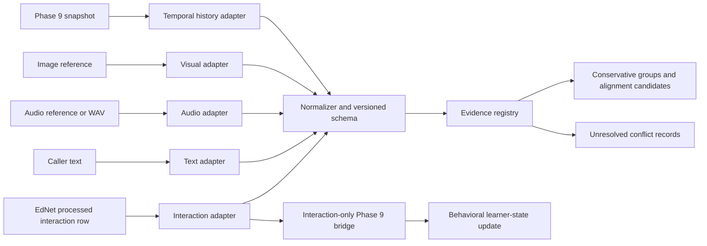
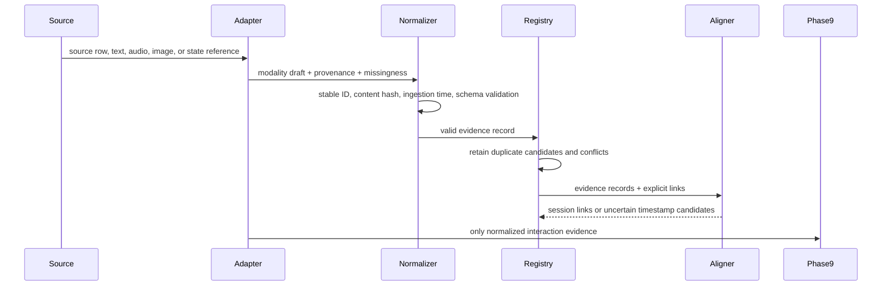
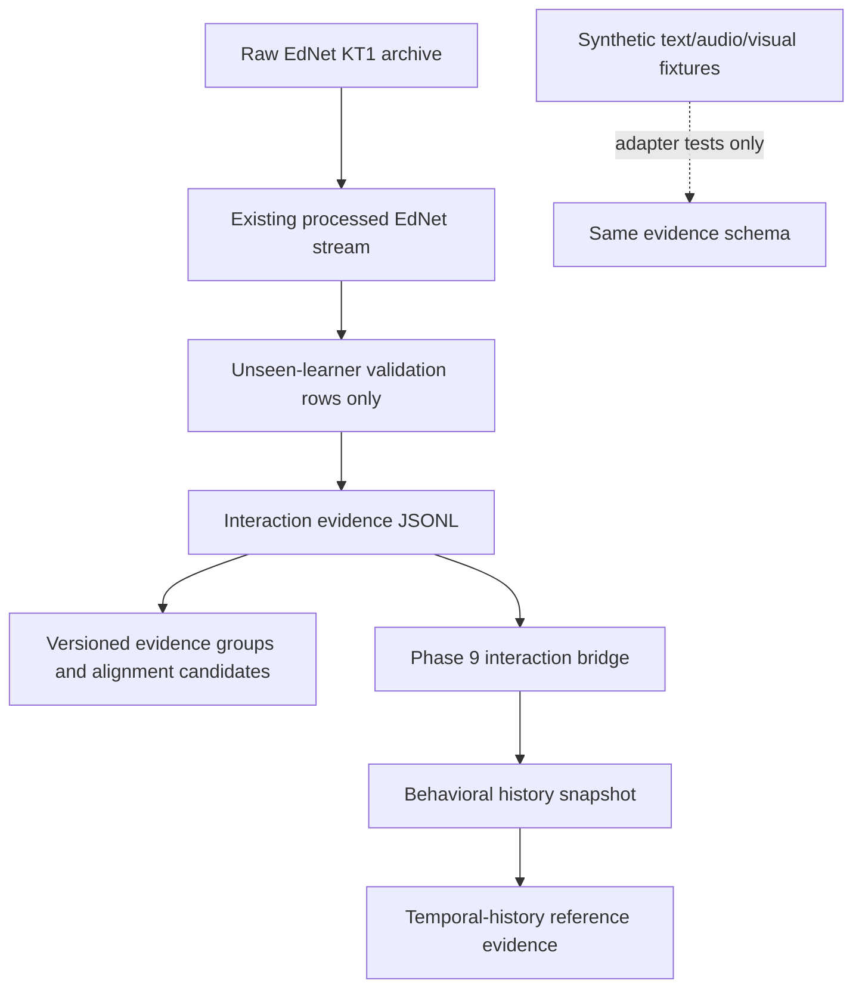

# Phase 10: Multimodal Evidence Modeling Architecture

**Status:** implemented evidence-record and adapter foundation; no learned multimodal fusion.

## Scope

Phase 10 standardizes evidence that is actually available, retains source links and uncertainty, and exposes a narrow bridge from normalized interaction records to the Phase 9 behavioral updater. The code accepts text, audio and visual references so future data can use the same contract. In the current workspace those three learner-authored modalities are absent; their adapters are covered with synthetic fixtures only.

An evidence record is an observation or a traceable derivation. It is not a claim that the learner understands, is confused, or holds a misconception. EdNet correctness remains an observed response outcome. Phase 9 remains a response-history summary.

## Components

### Normalized evidence record

The common record has schema version `1.0` and carries:

- learner and optional session IDs, evidence type and deterministic evidence ID;
- source event time, real normalization/ingestion time, source sequence and precision;
- dataset/file/record/modality provenance and processing version;
- modality-specific content or an external asset reference plus hash/metadata;
- extraction status, quality flags, missing fields and transformation history;
- uncertainty notes and explicit relations/duplicate candidates.

The JSON Schemas are in `schemas/evidence_record_v1.schema.json`, `schemas/evidence_group_v1.schema.json`, `schemas/evidence_alignment_v1.schema.json`, and `schemas/evidence_conflict_v1.schema.json`. The Phase 9 behavioral state contract used by the bridge is `schemas/learner_state_v1.schema.json`; the requested `docs/LEARNER_STATE_SCHEMA.md` filename is absent in this repository. See [`EVIDENCE_SCHEMA.md`](EVIDENCE_SCHEMA.md).

### Adapter responsibilities

| Adapter | Implemented behavior | Current validation source |
|---|---|---|
| Interaction | Maps existing processed EdNet fields, uses the existing skill-tag parser, retains source row order, question, answer, correctness, timestamp and raw-archive locator. | Real EdNet validation partition sample and synthetic unit rows. |
| Text | Preserves raw text, applies Unicode NFC and line-ending normalization, records whitespace-token count and optional language metadata. No semantic classifier. | Synthetic text fixture only. |
| Audio | Preserves the reference; hashes a local asset when available; reads WAV format, duration, sample rate and channel count with the standard library. Transcription is pending or explicitly failed unless supplied with provenance. | Generated WAV fixtures only; no learner speech or ASR. |
| Visual | Preserves the reference; hashes local images and reads PNG/JPEG format and dimensions. OCR remains pending or can be marked failed with an error. | Generated PNG fixture only; no learner artifact or OCR. |
| Temporal history | Projects a reference and summary of a Phase 9 snapshot, preserving timestamp and links to supporting interaction evidence. It does not copy the full event history. | Real EdNet-derived Phase 9 accumulator snapshot in the sample experiment; synthetic unit fixture. |

## Normalization and evidence lifecycle

Event time is never replaced with ingestion time. EdNet's numeric shifted timestamp is retained as its source string with millisecond precision and a source description. Text/audio/visual timestamps are unknown unless the caller supplies the timestamp and precision. Ingestion and processing times are generated at normalization and use UTC.

The registry detects identical content hashes within a learner as *possible* duplicates, records the relation on both records, and keeps both observations. It does not reconcile source events or remove repetitions. Conflicts are separate unresolved records with the involved evidence IDs, modality names, event-time relationship and a null cognitive interpretation.

## Grouping and alignment

Records are grouped only by a matching learner, dataset and nonempty `session_id`, or an explicit related-evidence link. EdNet's processed `session_id` is preserved; `solving_id` is retained as content and is not substituted for a session ID. A record without a shared session stays a singleton unless explicitly linked.

Timestamp proximity can produce an alignment candidate only for the same learner when both event times are numeric milliseconds. A same clock source without a shared session is medium uncertainty; different or unverified clock sources are high uncertainty. Timestamp candidates remain separate groups. Candidate records are kept in local `alignment_candidates.jsonl` output and do not assert that devices were synchronized; learner-level JSONL exports are excluded from Git. Explicit relationships and source-scoped session relationships are described in [`EVIDENCE_ALIGNMENT_REPORT.md`](EVIDENCE_ALIGNMENT_REPORT.md).

Each group includes the present modalities and an availability mask. “Unavailable” means no evidence item for that modality is present in the group; it is not a negative observation. A present audio/image record with incomplete extraction remains present and carries its own pending/failed status and missing fields.

## Phase 9 boundary

`apply_interaction_evidence` maps only interaction records into the existing `LearnerStateAccumulator`. It preserves learner, source order, source timestamp, question, correctness, skill tags and duplicate flag. Other modalities cannot update Phase 9. The Phase 9 formulas and schema were not changed in this phase. The integration trace stores the before/after summary and a Phase 9 reference record linked to the two interaction records.

## Data flow summary

## Implementation boundaries

- Implemented: versioned records, adapters, validation, content fingerprints, stable IDs, missingness, duplicate candidates, unresolved conflicts, conservative grouping/alignment and Phase 9 interaction integration.
- Validated on real data: only EdNet interaction and a small behavioral snapshot constructed from its validation partition.
- Validated synthetically: text, audio metadata, visual metadata, extraction-failure states, missing modalities, timestamp candidates and conflict handling.
- Not implemented: ASR/OCR inference, visual or language interpretation, learned multimodal fusion, cognitive diagnosis, misconception detection, and representation selection.

The reproducible bounded run uses one labeled event per distinct validation learner to avoid overweighting frequent users; it is a coverage sample, not a statistically representative event sample. Results and limits are described in [`PHASE10_EVALUATION.md`](PHASE10_EVALUATION.md). Do not begin the next project phase based on this implementation alone.
