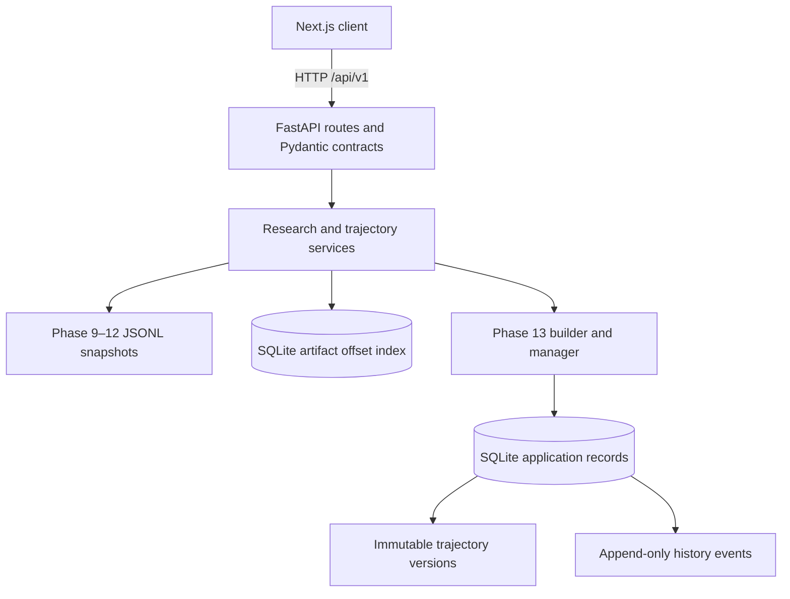

# Phase 14 Backend Architecture

## Scope

Phase 14 adds a local FastAPI application around the Phase 9–13 research code. The service layer keeps HTTP handling separate from domain logic and persistence. Existing Phase 9–12 report files remain immutable and are read through byte-offset indexes; Phase 13 trajectory changes made through HTTP are stored in SQLite.

The API binds to `127.0.0.1:8000` in the documented development command. It exposes no filesystem path parameter. Artifact paths come from trusted environment configuration, and responses never include those paths.

## Integration findings

| Phase | Actual callable/data interface | API behavior |
|---|---|---|
| 9 | `LearnerStateAccumulator.update()` / `snapshot()` and `build_state_from_rows()` build a state from ordered interaction rows. Existing validation snapshots are in `validation_learner_states.jsonl` (2.6 GB). | Read-only lookup of an existing snapshot by learner ID. The API does not replay the full interaction dataset per request. |
| 10 | `InteractionAdapter`, other modality adapters, `normalize_evidence()`, validators, and the in-memory `EvidenceRegistry`. The bounded run has real interaction evidence and grouped evidence records. | Read-only evidence and grouping lookup. Each evidence response includes group and alignment annotations when indexed. |
| 11 | `estimate_cognitive_state()` requires a Phase 9 snapshot and a complete, matching chronological Phase 10 interaction prefix. `CognitiveStateHistory` is in-memory. | Read-only lookup of the latest saved cognitive-state estimate, preserving uncertainty and references. The API does not recalculate it from a partial sample. |
| 12 | `build_representation_plan()` consumes a cognitive state plus optional matching behavioral/evidence/context inputs. `RepresentationPlanHistory` is in-memory. | Read-only lookup of saved plans. Decision, capability, and delivery status remain those recorded in the source plan. No representation is executed. |
| 13 | `build_trajectory()` creates a validated initial object. `TrajectoryManager` supports create, activate, pause, step advancement, and broader internal diversion/resumption operations over `TrajectoryHistory`. | Creation and the three exposed actions call the Phase 13 builder/manager. The service reconstructs manager history from SQLite before a mutation and persists resulting versions/events in one transaction. Diversion reads are durable; no diversion mutation route is exposed. |

Phase 13 sample JSONL is not imported: its builder supplies a placeholder goal, which is not a learner-authored objective. API trajectory creation requires a caller-supplied goal and target concept. The API does not accept prerequisite links.

The Phase 9 evaluation reports model predictions unavailable; there is no application model loader/inference service. Health reports model inference as unavailable.

## Services

- `ArtifactService` verifies source size and modification time against the SQLite index, resolves records by indexed byte range, and returns group references.
- `ResearchService` exposes learner availability and Phase 9–12 snapshots without changing their source schemas.
- `TrajectoryService` validates references against the indexed source learner, calls the Phase 13 builder/manager, and writes a current snapshot plus immutable versions/events.
- Routers only validate requests, invoke services, and wrap results in the standard response envelope.

## Security and availability

CORS defaults to `http://localhost:3000` and `http://127.0.0.1:3000` and is configurable. Authentication is not implemented because no identity provider exists in the repository. The development server binds to loopback; deploy only behind an authenticated, access-controlled service. CORS is not authentication.

Health reports each artifact index, the database, and module-specific capability. It reports `degraded` while a configured Phase 9–12 source is missing or unindexed. The server does not scan the 2.6 GB Phase 9 file on startup; run the explicit index command once. A source file whose size or modification time changes is treated as stale until reindexed.

See [API Design](API_DESIGN_SPECIFICATION.md), [Database Architecture](DATABASE_ARCHITECTURE.md), [Persistence Methodology](PERSISTENCE_METHODOLOGY.md), [Integration Report](BACKEND_INTEGRATION_REPORT.md), and [Evaluation](PHASE14_EVALUATION.md).
