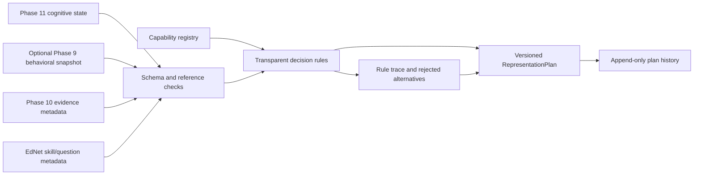

# Phase 12: Representation Intelligence Architecture

## Scope

Phase 12 turns a Phase 11 estimate into an auditable `RepresentationPlan` recommendation. The module does not generate or deliver teaching content, run an intervention, estimate modality preference, or predict learning benefit. It uses deterministic rules and emits low confidence for support for a recommendation only.

## Data flow

The Phase 11 concept estimate already embeds Phase 9 observed performance statistics. Callers may additionally pass the original Phase 9 snapshot; if they do, learner identity, timestamp and concept statistics are cross-checked. Evidence records may be passed for human representation annotations and must be referenced by the supplied cognitive state.

## Components

| Module | Role |
|---|---|
| `representation_taxonomy.py` | Versioned IDs and descriptions for eight representation categories. |
| `availability_registry.py` | Declares available, planned or unavailable delivery capability; only available entries with a provider or concrete content IDs can be selected. |
| `content_grounding.py` | Maps EdNet skill tags to related item metadata while excluding answer keys and learner response data. |
| `decision_rules.py` | Evaluates sparse evidence, repeated errors, declining/inconsistent performance, human mismatch annotations, conflicts, and continuation. |
| `plan_builder.py` | Links estimates, evidence, objective availability, context, evaluation strategy and limitations into a validated plan. |
| `plan_history.py` | Retains immutable, version-linked plans for each learner/concept trajectory. |
| `representation_schema.py` | Applies JSON Schema plus semantic checks for availability and evidence references. |

## Boundaries

- EdNet skills remain identifiers, not validated concept names. The local archive supplies question/lecture IDs, tags, parts, bundle/explanation references and lecture metadata, but no local explanation text, lecture video assets, prerequisite map or worked-example source was identified.
- No modality is selected because of a predicted learner preference. A modality-specific mismatch rule requires a human annotation that names the affected representation and explicitly suggests an alternative.
- A plan with no registered available capability leaves `selected_representation` null and requests evidence or defers. Candidate alternatives remain listed with availability and rejection reasons.
- Plans recommend downstream actions only. A follow-up measure records observable evidence and exposure; it is not interpreted as causal learning benefit.
- The real-data builder reuses the bounded Phase 11 validation sample. It does not load the processed EdNet table, inspect locked-test records, or retrain models.

See [`REPRESENTATION_DECISION_METHODOLOGY.md`](REPRESENTATION_DECISION_METHODOLOGY.md), [`REPRESENTATION_PLAN_SCHEMA.md`](REPRESENTATION_PLAN_SCHEMA.md), and [`REPRESENTATION_EVALUATION.md`](REPRESENTATION_EVALUATION.md).
